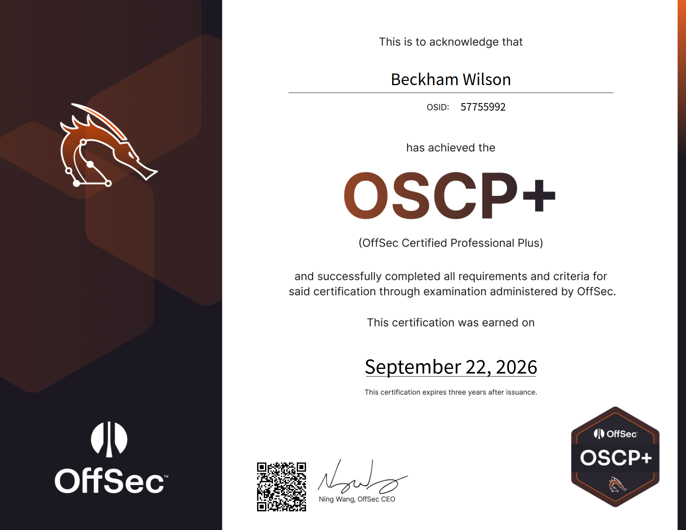

## Introduction

The OSCP (OffSec Certified Professional) is OffSec's junior pentesting cert: the PEN-200 course plus an exam covering web, privilege escalation, pivoting and Active Directory.

The exam has two parts:
* **Hacking phase:** 23 hours 45 minutes, proctored.
* **Reporting phase:** another 24 hours to submit your report.

You can skip the course material and videos and focus on labs instead. That's part of how I passed in under a month.

**Why I took it:**
* It's the cert recruiters ask for.
* I'd already passed CWES and CPTS, and found the OSCP an easier version of the CPTS.
* My employer paid for it :) Thank you to Aura Infosec.

## Before You Start

**Pricing:** The PEN-200 bundle was about $1,749 USD, which includes 90 days of lab access and one exam attempt.

**Who it's for:** Not beginners. You should be comfortable with the Linux command line, Windows basics, core networking, and reading and modifying code. The course is also pretty dense for 90 days of lab access. Even with my background, it took a very focused month just to finish the challenge labs, without even reading the course material or doing the module labs.

## My Background & Preparation

- BSc in Computer Science
- ~2 years as a full stack developer, then ~6 months as a junior pentester
- CWES and CPTS passed
- ~50 HackTheBox machines, ~25 Proving Grounds Play boxes
- All 10 PEN-200 challenge labs
- LainKusanagi OSCP-LK Practice Exam

My CPTS training was probably the biggest help in preparing for the OSCP. Honestly, I'd go as far as saying that anyone who has passed the CPTS should be able to pass the OSCP with relatively little additional practice. My dev background also made modifying exploit code easier, and day-to-day pentesting meant I was already familiar with the pentesting.

I barely read the PEN-200 course material, mostly just dipping into it out of curiosity to learn about some of the out-of-scope techniques. I didn't solve every box alone either; I checked walkthroughs when I got stuck, spammed the Discord help channels quite a bit hahah, and generally tried to cover as many machines as possible.

The challenge labs were useful but pretty unstable. I ran into VPN issues, mostly around MTU settings, and some services were just buggy. Some labs also felt poorly configured, with so many possible attack paths that I ended up repeating the same privesc checks over and over. Proving Grounds is a better use of your time than HTB, as the difficulty, style and exposure are closer to the actual exam.

### Labs worth doing

OffSec's numbering, in order:
0. Secura
1. Medtech
2. Relia
3. Skylark
4. OSCP A
5. OSCP B
6. OSCP C
7. Zeus
8. Poseidon
9. Feast
10. Laser

Avoid the first four (0–3). The first three are very basic and offer very little exploitation experience, while Skylark is extremely unstable.

OSCP A, B, and C (4–6) are the closest to the actual exam. OSCP-LK and Labs 7–10 are also worth doing. After completing those, focus the rest of your time on the Windows machines in Proving Grounds Play.

If you're looking for something a bit more challenging, try some of the HTB boxes from TJ Null's or Lain's list.

## What the Exam Is Actually Like

**Format:** Six machines: three standalones worth 20 points each (10 for initial access, 10 for privesc) and a three-machine AD set worth 40. You need 70 to pass. (Note: After December 1, 2026, the scoring system will change.)

**The machines:** A wide mix of services (SNMP, POP3, RPC, SMB and others), but the vulnerabilities aren't exotic. Web is mostly basic payloads, with a lot of enumeration. The exploits aren't hard, but they do take some manual work.

- **The first PoC almost never works.** Try several PoCs, change the IP and port, swap the payload, fix paths or version mismatches, and adapt from a writeup.
- **The AD set was the easiest part.** It's a narrow slice of AD in the syllabus, but in my exam, and in OSCP A, B and C, it didn't really involve classic "AD" attacks.
- **Skip phishing, client side attacks, AWS, AD lateral movement and evasion.** None of it came up.

### Pivoting with Ligolo-ng

Learn this until it's automatic. Set up the tunnel and add a route to the internal subnet. For ports only listening locally on the pivot host, use `240.0.0.1`. Write your own step-by-step recipe in your notes.

### Windows privesc

Windows privesc is what you really need to focus on. Here's the routine I usually run, in order:
1. Check `C:\` for non-default folders.
2. Run `tree /F /A .` in `C:\Users\` and look for scripts, notes, backups and credentials.
3. Check `Program Files` for non-default software.
4. Run `whoami /all`, then PrivescCheck, then WinPEAS.
5. Check scheduled tasks.

For post-exploitation, credentials are usually sitting somewhere obvious:
- Scripts, batch files and scheduled task definitions
- PowerShell history (`ConsoleHost_history.txt`)
- The registry (saved RDP/autologon creds, PuTTY sessions)
- The local SAM database
- `ProgramData` and `AppData` (app configs, saved sessions, cached creds)
- Config/`.ini`/`.xml`/`.env` files, especially web app and IIS configs
- Browser saved passwords
- Backup or `.bak` files, and databases
- Encrypted files (zips, archives, keepass vaults, private keys)

## My Exam Timeline

- **tldr:** 5 hours (60 pts) -> +5 hours (70 pts) -> +3 hours (90pts)
- **yippee quick W's:** Got to **60 points** (20 from AD, two standalones rooted) within about 5 hours.

- **pain and suffering -> yippee:** then spent another 5 hours trying to get the DC and user on the remaining standalone. Passed YIPPPEEE!!! Got **70 points** via user on the third standalone. I didn't enumerate one of the ports enough.
- **more pain and suffering (report):** Spent a couple of hours that night writing the report.
- **huh Domain Admin without doing AD attacks:** After some rest, I got the DC in a couple of hours. Finished with **90/100** points.

Stress-wise, I found the exam itself manageable, although I was pretty stressed during the preparation. There's a bit of a stigma around the OSCP being extremely difficult, which I don't entirely agree with. A lot of the machines felt like variations of things I'd already practised. That said, the sheer amount of screen time from studying and sitting the exam was exhausting. By the end, I was pretty checked out, both physically and mentally.

## Key Tips & Tricks

- **Focus on Windows foothold and privesc.** AD alone is worth 40 points and is entirely Windows, so being solid on Windows gives you a big head start before you even touch the standalones. It's also sequential - get that first flag and the rest tends to follow, whereas missing it caps you at 60, an automatic fail. You'll likely only see 1-2 Windows standalones too, so a foothold (and ideally privesc) on those covers most of the rest of the points you need.
- **Get volume.** Do lots of practice boxes to get comfortable with common services (HTTP, SMB, FTP, RPC, POP3, databases, etc.). Learn to recognise services, enumerate them properly, and spot misconfigurations.
- **Use walkthroughs.** Give the labs an honest attempt, read the walkthrough when you get stuck, work out what you missed, and move on. Add what you learn to your notes.

- **Think dumber.** The exploits are basic: simple web payloads (SQLi, command injection, LFI), public exploits, and weak or default credentials (`admin:admin`, username as password). Prioritise simple exploits/low-hanging fruit before attempting complex exploits.
- **Enumerate for what looks off:** unusual ports, services that aren't normally installed, odd files. If you're stuck, enumerate again. Most stalls come from missed enumeration, not missing knowledge.
- **Post-exploitation to the moon.** GOOOOO NUTS. Don't stop at a root shell. Loot file shares, check history files, configs, browser credentials stores, hunt for plaintext credentials in scripts, databases and the registry, and reuse anything you find across every other service and box. Then chain it into the next machine or the next privilege level.
- **Report as you go.** Capture the necessary evidence while you're doing it.

## Final Thoughts

The OSCP tested my persistence just as much as my technical skills. A lot of it comes down to sticking to your methodology, working through your notes, continuing to enumerate, and not giving up when you're stuck. Sometimes you just need to think dumber rather than try harder :)

I found it much more manageable than its reputation suggests, especially coming from a CPTS background. If you've passed the CPTS, you probably won't need much additional preparation. Focus on Windows (foothold + privesc), enumeration, pivoting and getting plenty of hands-on practice. Don't overcomplicate things.

It's still a worthwhile cert to have on your CV, but don't buy into the dogma surrounding its difficulty.

If you have any questions or just want to chat about the OSCP, feel free to reach out on LinkedIn or Instagram. Always happy to help where I can!

Good luck!

### Useful Tools and Links :)

### Enumeration
- **Nmap** - The standard port scanner.
- **feroxbuster** - Directory brute-forcing with recursive search. dirb, ffuf and gobuster are also good alternatives.

### Shells & Payloads
- **MSFvenom** - Generates reverse shells, especially for executable payloads (`.exe`, `.elf`).
- **Netcat** - Executing/listening for reverse shells, checking connectivity, transferring data.
- **rlwrap** - Pairs with Netcat for proper keyboard input (arrow keys, backspace) on a reverse shell.
- **Evil-WinRM** - Shell for when WinRM (port 5985) is open. Handles upload/download on its own.
- **xfreerdp3** - An RDP client. The most stable one I used.

### Privilege Escalation
- **WinPEAS / LinPEAS / PrivescCheck** - Automated privesc enumeration for Windows and Linux.
- **pspy** - Monitors Linux processes without root, useful for Linux privesc.
- **mimikatz** - Extracts credentials from Windows memory. Needs admin privileges.
- **John the Ripper / hashcat** - Password cracking. hashcat is more feature-rich; fall back to John for hashes it doesn't support. Use the `*2john` scripts (`ssh2john`, `zip2john`, etc.) to generate crackable hashes.

### Active Directory
- **NetExec** - Successor to CrackMapExec. Useful once you have credentials and need to find which hosts they work on. Has useful modules like `lsassy`, and can do basic AD operations like password resets.
- **BloodyAD** - AD privilege abuse swiss-army knife: resets, ACL abuse, Kerberos tickets, and more.
- **BloodHound / SharpHound** - Finds AD misconfigurations. BloodHound is easy to set up with Docker. Run `bloodhound-python` from Kali or `SharpHound.exe` from within Windows to collect.
- **Impacket** - Core toolkit. Most used:
  - `impacket-psexec` - PsExec
  - `impacket-GetUserSPNs` - Kerberoasting
  - `impacket-GetNPUsers` - AS-REP Roasting
  - `impacket-mssqlclient` - MSSQL client
  - `impacket-secretsdump` - alternative to `mimikatz.exe`
  - `impacket-ntlmrelayx` - NTLM relay
  - `impacket-smbclient` - SMB client
  - `impacket-smbserver` - spins up an SMB server

### File Transfers
- A basic Python HTTP server works for uploads and downloads both ways.
- `scp` if SSH is available, SMB if that's available.
- `curl` or `certutil` for pulling binaries onto Windows hosts.

### Pivoting
- **Ligolo-ng** - Tunneling and pivoting via a TUN interface; use `240.0.0.1` to reach ports only listening locally on the pivot host.
- **SSH local/remote port forwarding** - Good for a single port when you don't need a full tunnel.

### Websites
- **HackTricks** - A cybersecurity knowledge base covering a huge range of techniques. Worth checking whenever you're stuck on something specific.
- **GTFOBins** - Unix binaries that can be abused for privesc, mainly.
- **PayloadsAllTheThings** - Payloads for common web exploits.
- **Lains List** - List of OSCP boxes for PG play and HTB
- **TJ Null List** - List of OSCP boxes for PG play and HTB (outdated but still good)
- **Reverse Shell Generator (revshells.com)** - Generates reverse shells in various formats.
- **0xdf blog** - HTB blog with writeups
- **ippsec** - YouTube videos for HTB

### Other
- **Obsidian** - Markdown notes. Spam use headings, links, bullet points, code blocks. Useful plugins Outliner, Paste mode, Zoom.
- **Visual Studio Code** - Reading/modifying PoCs, and occasionally writing my own.
- **tmux** - Terminal multiplexer, handy for juggling multiple shells and panes at once.
- **vim** - Quick file editing straight from the terminal.
- **Burp Suite (Community Edition)** - Web proxy to intercept and edit HTTP requests.

